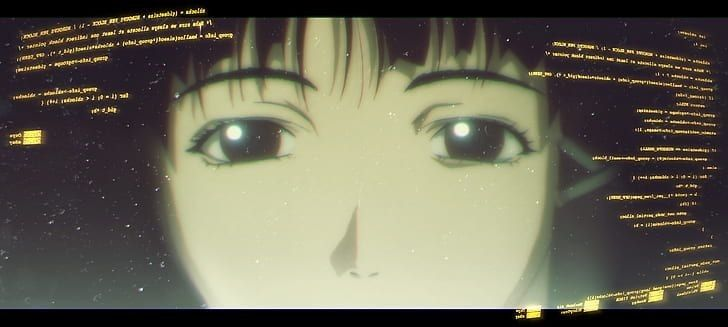

<h1 align="center">
  
  Hello!!! :3
  
</h1>

README.MD 1.0.1

  ■ Hi, I'm <b>Gabriel</b>, an Information Systems student interested in building things, understanding how they work, and making them my own ■
 
<b>(=w=)</b> a little bit of everything I'm working on lives down here <b>(=w=)</b>

  

  <kbd>&nbsp;■ trying ■ breaking ■ fixing ■ repeating ■&nbsp;</kbd>

 

---

## 

<table>
  <tr>
    <td width="50%" valign="top">
      <kbd>&nbsp;> about me_&nbsp;</kbd>
        
      I enjoy understanding how things work and finding ways to make them work better. I'm particularly interested in Linux, software development, and interface design, but I also enjoy exploring ideas outside those areas.
      I like experimenting, researching, and building things from the ground up. Whether it's customizing my desktop environment or creating something entirely new, I care about both how things work and how they come together.
    </td>
    <td width="50%" valign="top">
      <kbd>&nbsp;> Currently exploring_&nbsp;</kbd>
        
      <b>hardware:</b> ThinkPad 
      <b>system:</b> CachyOS 
      <b>wm:</b> Hyprland 
      <b>shell:</b> ... 
      <b>editor:</b> ...
        
    </td>
  </tr>
</table>

 

## 

<table>
  <tr>
    <td width="50%" valign="top">
      <kbd>&nbsp;> Practis_&nbsp;</kbd>
        
      my Hyprland dotfiles
        
      <a href="https://github.com/GabrielAlgumaCoisa/Practis">→ view repository</a>
       
    </td>
    <td width="50%" valign="top">
      <kbd>&nbsp;> RPG project_&nbsp;</kbd>
        
      short project description.
        
      <a href="https://github.com/GabrielAlgumaCoisa/RPG-F-F">→ view repository</a>
    </td>
  </tr>
</table>

 

## 

**Web & Programming**

**Environment & Tools**

**Creative Tools**

 

<table align="center">
  <tr>
    <td width="50%" valign="top">
      <kbd>&nbsp;> listening_&nbsp;</kbd>
        
      
    </td>
    <td width="50%" valign="top">
      <kbd>&nbsp;> links_&nbsp;</kbd>
        
      • <a href="https://gabrielalgumacoisa.github.io/RPG-F-F/">RPG website</a> 
      • <a href="https://gabrielalgumacoisa.github.io/Portifolio/contato.html">contact</a>
    </td>
  </tr>
</table>
 

  

